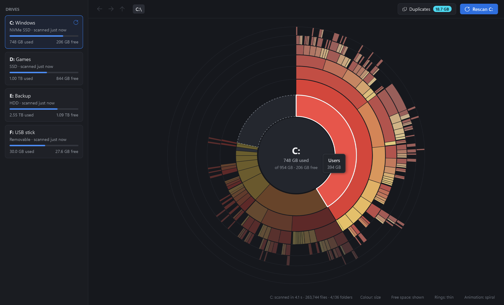

# UberDisk

A modern, trimmed-down take on OverDisk v0.11 (2005) for Windows 10/11 with SSDs. It does one thing:
it shows a drive as a sunburst ("layered cake") so you can find what to delete.



## Download

The [latest release](../../releases/latest) has two downloads of the same program for Windows 10/11 x64. Neither
needs admin rights or a .NET install.

- **`UberDisk-Setup.exe`, the installer.** Installs for your Windows user only, into
  `%LOCALAPPDATA%\Programs\UberDisk`, adds UberDisk to the Start menu (and, if you tick it, the desktop), and can be
  removed again under Settings > Apps.
- **`UberDisk.exe`, the portable version.** One self-contained file you run from anywhere; there is nothing to
  install. To remove it, delete the file.

The builds are not code-signed, so Windows SmartScreen may warn the first time: choose "More info" then "Run anyway".

**Updates:** at startup UberDisk asks GitHub whether there is a newer release. If there is, a note in the drive rail
offers **Install and restart**: it downloads the new `UberDisk.exe`, checks it against the SHA-256 GitHub lists for
it, puts it in place of the old one and restarts, the same way for the installed and the portable copy. Nothing
installs without that click. Click the version number at the bottom left to check now or to turn the startup check
off.

Settings and the window's size and position are kept in `%APPDATA%\UberDisk\settings.ini`. If UberDisk hits an error,
the details go to `%LOCALAPPDATA%\UberDisk\crash.log`, and the error message offers to copy them and open a GitHub
issue.

## Build and run

You need the .NET 8 SDK or newer (`dotnet --version`). The app targets .NET 8 and also runs on newer runtimes.

```
build.cmd            :: builds Release into .\publish and starts UberDisk.exe
build.cmd release    :: runs the tests, then builds the downloads into .\dist (UberDisk\UberDisk.exe, UberDisk-Setup.exe)
```

or by hand:

```
dotnet run --project src\UberDisk.App -c Release
dotnet test                                    :: core unit tests
```

No admin rights are needed. Run as administrator only if you want the "Unscanned (system / no access)" slice to shrink.

## How to use it

- **Drive rail (left):** every drive with label, type (NVMe SSD / SSD / HDD / USB …), fill bar, used and free space,
  and scan state. Click a card to switch; the active card has a rescan icon. Or press the drive letter.
- **Chart:** click a folder to zoom in, click the centre disc (or Backspace) to go up. Back/forward with Alt+←/→ or the
  mouse side buttons. The breadcrumb is clickable.
- **Hover** shows size on disk, % of parent, % of drive, and file/folder counts. **Right-click**: Zoom into folder,
  Open in Explorer (Ctrl+E), Copy path (Ctrl+C), Rescan this folder only, and **Delete**.
- **Delete** moves the right-clicked file or folder to the Recycle Bin after a confirmation that shows the full path,
  size and file count (Cancel is the default; Enter and Esc cancel). It is never offered for the drive root, the
  "Unscanned" segment, the "N smaller files" bundle, empty space or the free-space arc, or while a scan runs. Right
  before the Recycle Bin call every check runs again: same path as confirmed, still in the chart, same item on disk
  (not replaced), not a junction or symbolic link, and no link anywhere inside a folder. If anything changed, nothing
  is deleted. Paths over 259 characters are refused (the Recycle Bin can't take them).
  Network and removable drives are refused too (Windows may delete for good there). Afterwards the chart counts the
  item in the drive's $Recycle.Bin folder, where it still takes up space until the Recycle Bin is emptied.
- **Rescan / F5** rescans the current drive and turns into **Stop** while it runs. Stopping a rescan brings back the
  previous result.
- **Footer toggles:** *Colour* (size: biggest siblings are red, small ones yellow; view; folders), *Free space*
  (shown: the circle is the whole disk, with free space as a dark arc), *Rings* (thin: deeper rings get thinner so each
  ring has the same area; even) and the scan animation.
- **Duplicates:** after each scan UberDisk looks for identical large files (same length and same SHA-256 of the whole
  content). Hovering a file that has copies draws lines to them; the **Duplicates** button highlights every group on
  the chart.

## What's inside

```
src/UberDisk.Core         no UI; unit-tested on any OS
  Scanning/Win32DirectoryReader.cs   one GetFileInformationByHandleEx(FileFullDirectoryInfo) call per 128 KB of
                                     entries, real allocated size from NTFS, \\?\ long paths, Unicode
  Scanning/ParallelScanner.cs        N worker threads share a folder stack; sizes roll up live so the chart can
                                     fill in while scanning; junctions/symlinks skipped; the 48 largest files per
                                     folder kept by name, the rest grouped into "N smaller files"
  Drives/DriveMeta.cs                drive list, NVMe/SSD/HDD detection (seek penalty + bus type, no admin)
  Drives/ScanCoordinator.cs          per-drive cache + scan queue (see below)
  Viz/SunburstLayout.cs              OverDisk's pie geometry: 12 o'clock start, clockwise, by size, 3 px threshold
  Viz/Palette.cs                     mockup A palette: hue per top-level folder, lighter with depth, files greyer
  Viz/Navigator.cs                   zoom path + back/forward history, kept as names so it survives rescans
  Updates/Updater.cs                 latest GitHub release, download + SHA-256 check, swap the running exe
src/UberDisk.App          WPF shell (layout B) + SkiaSharp renderer
  SunburstPainter.cs                 all drawing (no WPF), SunburstView.cs = mouse handling
  MainWindow.xaml(.cs)               drive rail, top bar, breadcrumb, hover card, context menu, keys
  MainWindow.Update.cs               update check at startup, the update note in the rail, install and restart
tests/UberDisk.Core.Tests xUnit tests for scanner, layout, queue, palette
installer/                UberDisk.iss (Inno Setup, per-user, no admin) and UberDisk.Setup.proj, which fetches
                          the Inno Setup compiler from NuGet and builds dist\UberDisk-Setup.exe
tools/Preview             renders the chart to PNG headless (used to check the drawing without Windows)
```

### Performance

| OverDisk annoyance | What UberDisk does |
|---|---|
| GUI locks while scanning | Scans run on their own threads. The UI refreshes 4× a second from the live tree. |
| Switching drives rescans | Each drive's tree is kept for the session. Switching shows it instantly; only Rescan scans again. |
| No scan queue | On start the system drive scans first (foreground, full speed). All other fixed and USB drives then scan one after another in the background, with Windows background CPU/IO priority, and pause while a foreground scan runs. Switching to a drive that is mid-scan promotes it. |

SSDs get one and a half threads per physical core (4–16); HDDs get 2 threads, since parallel reads only make them seek.

### Not done yet

- **Incremental rescan** (USN journal) and **MFT reading** for WizTree-class speed. Both need admin rights; planned
  as an optional fast path, with today's scanner as the fallback.
- Hard links (WinSxS) are counted once per link, like Explorer does.

## Licence

MIT, see [LICENSE](LICENSE). UberDisk is an independent C# program inspired by OverDisk. It follows OverDisk's look and some of its layout rules (ring sizes, colouring by size), but contains no code or files from OverDisk.
